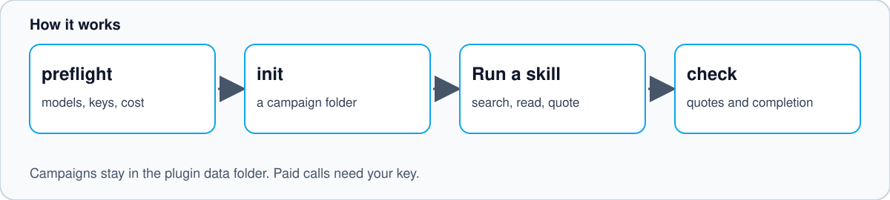

# Deep research


Three Hermes Agent skills for research backed by saved sources and checked quotations.

| Skill | Use it for | Output |
|---|---|---|
| [deep-research](skills/deep-research/SKILL.md) | Multi-part research with independent review | Plain brief and reference pack |
| [deep-research-fast](skills/deep-research-fast/SKILL.md) | A focused question with parallel search | One answer with numbered citations |
| [deepest-research](skills/deepest-research/SKILL.md) | A focused question that needs exact detail | One answer built from a base run, follow-up runs and an optional review round |

All modes retain source text, file hashes and verbatim quotes. A quote matching a page does not prove the claim. Meaning checks and independent review remain necessary.

## Requirements

- Python 3.11 or later and Git.
- [Hermes Agent](https://hermes-agent.nousresearch.com/docs) for live workers, search and session records.
- Configured model access. Full-mode writing and provider verification use OpenRouter.
- Optional integrations for issue tracking, diagrams and guarded acquisition. Local deliverables export uses the bundled exporter.

The local configuration and schema checks require `PyYAML>=6,<7` and `jsonschema>=4,<5` (declared in `pyproject.toml`). Install runtime and test dependencies with:

```bash
python3 -m venv .venv
. .venv/bin/activate
python3 -m pip install -e ".[dev]"
```

## Install as a Hermes plugin



```bash
hermes plugins install j78f88/hermes-deep-research
hermes plugins enable hermes-deep-research
```

Start a new Hermes session and run `/deep-research preflight`. To check a local checkout first, run
`hermes plugins validate .` and `hermes plugins doctor --ci .` from its root.

This repository is a native Hermes plugin (`plugin.yaml` and `__init__.py`). On load, `register(ctx)` registers:

- **Skills:** `deep-research`, `deep-research-fast`, and `deepest-research`
- **Tools:**
  - `deep_research_preflight` — inspect role models, check credential availability, and estimate token/cost bounds before starting a fast, deepest, or full campaign run
  - `deep_research_init_campaign` — scaffold a local deep-research campaign directory (defaults under `plugin_data_dir("hermes-deep-research")`)
  - `deep_research_check_completion` — run the deterministic completion and quote-integrity check on a campaign root
- **Slash command:** `/deep-research`, with `preflight`, `estimate`, `init`, `check` and `help`. See [Slash command help](#slash-command-help).

**Disclosure:** Paid model calls and online receipt verification connect to OpenRouter (`https://openrouter.ai/api/v1/...`) using `OPENROUTER_API_KEY`. Optional YouTube transcript acquisition (`acquire_youtube_apify.py`) connects to Apify (`https://api.apify.com/v2/...`) using `APIFY_TOKEN`. `OPENROUTER_API_KEY` is declared under `requires_env` and `APIFY_TOKEN` under `optional_env` in `plugin.yaml`. Both resolve through `agent.secret_scope.get_secret`. `os.environ` is read only when Hermes is not importable, so one profile never sees another profile's key. `.env` files are never opened directly.

**Storage:** the tools write only under `plugin_data_dir("hermes-deep-research")/campaigns`. A `campaign_root` argument must resolve inside that folder (symlinks included), and the folder itself is refused. Campaigns made elsewhere with the bundled scripts can still be checked with the scripts directly.

### Slash command help

`/deep-research`, `/deep-research help`, `-h`, `--help` and `?` print this text. A test keeps this copy in step with the code.

```text
/deep-research - research preflight, campaign scaffold and completion check

Usage:
  /deep-research preflight [mode] [question]   Show models, key state and cost estimate
  /deep-research estimate [mode] [question]    Same as preflight
  /deep-research init <target question>        Scaffold a local campaign folder
  /deep-research check <campaign_root>         Run the offline completion and quote check
  /deep-research help                          Show this message

mode is fast (default), deepest or full.

Examples:
  /deep-research preflight deepest How does X work?
  /deep-research init How does X work?
  /deep-research check <campaign_root printed by init>

Notes:
  These commands make no network calls and spend nothing. Key state is shown as
  present or missing, never as a value.
  Paid research runs through the bundled skills and needs OPENROUTER_API_KEY.
  Campaigns are saved under the plugin data folder.
  The same steps are available to the agent as deep_research_preflight,
  deep_research_init_campaign and deep_research_check_completion.
```

In `/help`, Hermes lists the command as `/deep-research preflight|estimate|init|check [args] | help`.

### Troubleshooting

| You see | Cause and fix |
|---|---|
| `OpenRouter key present: False` | Add `OPENROUTER_API_KEY` to your Hermes secret store. Preflight and init still work without it. Paid runs do not. |
| `Unknown subcommand: ...` | Use one of `preflight`, `estimate`, `init`, `check` or `help`. |
| `campaign_root must be a folder inside the plugin campaigns folder` | Pass the folder that `init` printed. Campaigns made elsewhere can be checked with the bundled scripts directly. |
| `Campaign manifest not found` | The folder is not a campaign. Run `/deep-research init <question>` first. |
| `/deep-research` is not found | The plugin is installed but not enabled. Run `hermes plugins enable hermes-deep-research` and start a new session. |

## Configure local paths

The scripts resolve the following environment variables. They expand `~` in their values.

| Variable | Default | Purpose |
|---|---|---|
| `DELIVERABLES_EXPORT_PATH` | `~/research-deliverables` | Optional reviewed Markdown deliverables export |
| `RESEARCH_ARCHIVE_ROOT` | `~/.hermes/research-archive` | Default campaign storage |
| `SOURCE_INTELLIGENCE_ROOT` | (optional, unset) | Optional local source corpus directory |

Full mode exports only the reviewed plain brief and reference pack directly into the flat export root. Use `--export-root` to declare another destination or `--no-deliverable-export` to suppress export. No import subdirectory, tag registry or navigation page is required. See the [deliverables export policy](skills/deep-research/references/deliverable-export-policy.md).

Put model and execution choices in each skill's `config/` files or supported run-scoped overrides. Bundled model catalogues are dated snapshots, not live availability guarantees. Confirm supported model IDs before paid work. Keep credentials in your configured secret store or environment, never in this repository.

## Start a full campaign

This command creates local files only. It does not search, call models, publish notes or create tickets.

```bash
python3 skills/deep-research/scripts/init_campaign.py \
  --target "Example research question" \
  --report-purpose factual \
  --root "$HOME/.hermes/work/example-research" \
  --no-deliverable-export
```

Follow the generated worker instructions and the full skill's review sequence. Complete research only after its completion checker returns `PASS`. Offline completion can return `HOLD`, never online publication approval.

## Run fast mode

Live runs use configured model and search access and may incur charges. Review the role choices and limits in `skills/deep-research-fast/config/fast-mode.json` first.

```bash
python3 skills/deep-research-fast/scripts/fast_research.py run \
  --question "How does X work?" \
  --root "$HOME/.hermes/work/example-fast-research"
```

Fast mode has different checks from full mode. Read its review and quote-check files before using the answer. A completed process does not guarantee a complete answer.

## Run deepest research

Deepest research runs fast mode once, then researches up to four gaps as separate fast runs at once. They share saved pages. One writer combines every checked finding into a single answer. If the review finds missing parts, one extra round researches them and the answer is rewritten and reviewed again. It makes more model calls than fast mode.

```bash
python3 skills/deep-research-fast/scripts/deepest_research.py run \
  --question "How does X work?" \
  --root "$HOME/.hermes/work/example-deepest-research"
```

The same command resumes an unfinished run or retries failed follow-ups. Read the readiness line at the top of the answer first. A rejecting review does not stop the run.

## Test

The suite uses local synthetic regression fixtures and mocked transports. It does not need model credentials or private campaigns.

```bash
python3 -m pytest skills/deep-research/scripts skills/deep-research-fast/scripts
```

Synthetic fixtures are not provider evidence or publication approval. The standalone replay ledger and prose checker are included so the suite does not depend on an external checkout.

## Safety and limits

Treat fetched pages, repository text and quotations as untrusted evidence, not instructions. Keep private context out of public workers. Do not execute researched code without separate approval. Deliverables export and other external changes require explicit scope and review.

The public distribution has no pre-admitted private campaign inventory. Existing legacy-layout research needs explicit purpose or separately reviewed, byte-bound admission. Verification does not grant permission to spend, publish or change production systems.

See [CONTRIBUTING.md](CONTRIBUTING.md), [SECURITY.md](SECURITY.md) and the [MIT licence](LICENSE).
